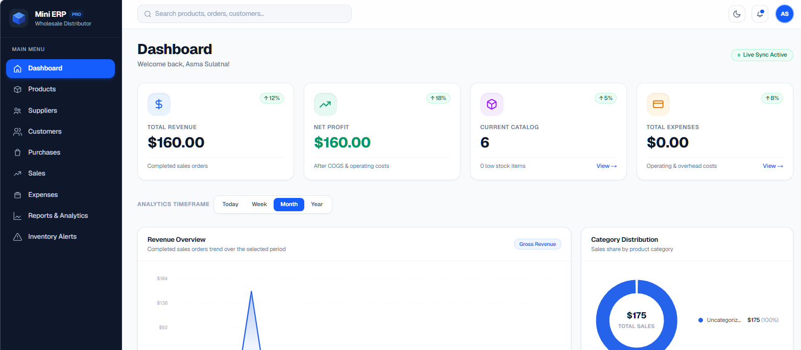
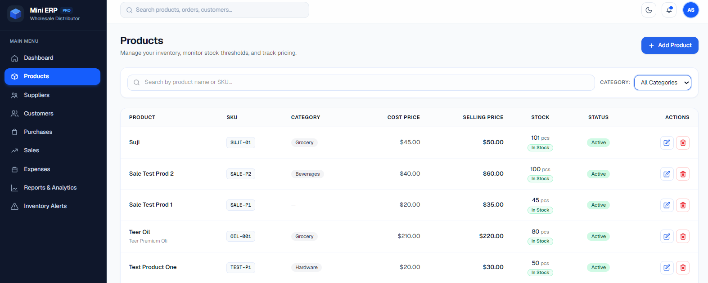
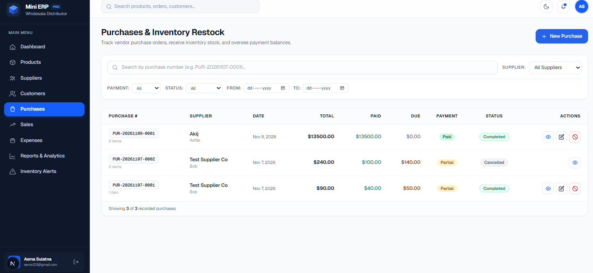
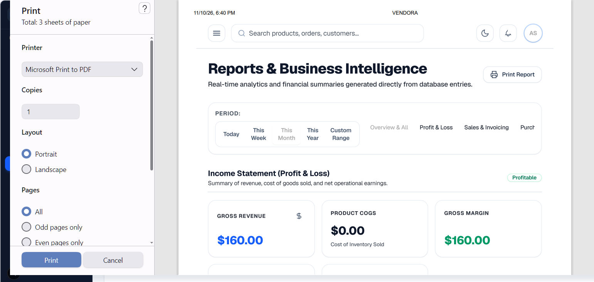
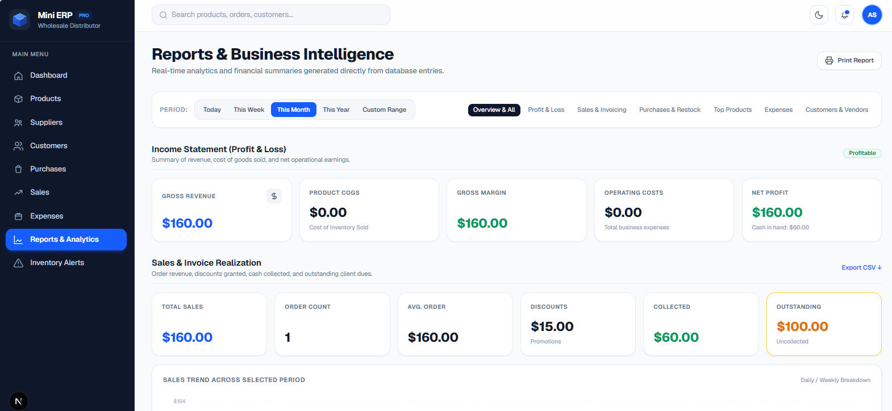

# VENDORA ERP —  Wholesale & Distribution Management System

> A full-stack, lightweight Enterprise Resource Planning (ERP) platform built with **Next.js 16**, **React 19**, **Node.js/Express**, and **MongoDB Atlas**. Designed to streamline inventory control, supplier purchases, B2B sales, expense tracking, and real-time financial reporting.

---

## 1. Problem Statement

Small-to-medium wholesale and distribution businesses often struggle with fragmented operations:
- **Disjointed Stock Records:** Tracking inventory in spreadsheets or manual paper ledgers leads to frequent stock discrepancies, accidental overselling, and lost sales.
- **Unreliable Cost & Profit Tracking:** Cost of Goods Sold (COGS) fluctuates over time; recalculating margins with static cost averages skews real profitability figures.
- **Operational Silos:** Purchases, customer orders, operational expenses, and supplier debts are rarely synchronized in real time.
- **Overcomplicated Legacy Software:** Enterprise-grade ERP software (SAP, NetSuite) is prohibitively expensive, cumbersome to deploy, and overly complex for small wholesale distributors.

**VENDORA ERP** bridges this gap with an intuitive, unified system that automates the core business workflow:
$$\text{Purchase Inflow} \longrightarrow \text{Stock Increment} \longrightarrow \text{Sale Outflow} \longrightarrow \text{Stock Decrement} \longrightarrow \text{Instant Financial Reporting}$$

---

## 2. Target Users

- **Wholesale Merchants & Distributors:** Bulk product distribution tracking across multiple retail clients.
- **Warehouse & Inventory Managers:** Stock controllers who monitor inventory thresholds, restock requirements, and low-stock warnings.
- **Sales & Billing Teams:** Front-desk and account representatives creating sales orders and issuing branded invoices.
- **Business Owners & Operators:** Decision makers needing real-time visibility into net profit, operating expenses, revenue trends, and inventory asset valuation.

---

## 3. Core Features

### 📊 Dynamic Executive Dashboard
- **Real-Time KPIs:** Live metrics for Total Revenue, Total Purchases, Total Expenses, Inventory Net Asset Value, and Net Profit.
- **Sales vs. Purchases Trend:** Interactive visual comparison chart tracking cash inflow vs. inventory replenishment over time.
- **Actionable Watchlists:** Instant view of low-stock and out-of-stock items requiring urgent purchase orders.
- **Recent Activity Feed:** Chronological transaction log of recent customer sales and supplier purchases.

### 📦 Product & Inventory Management
- **Product Registry:** SKU code, product title, category classification, purchase price, selling price, and stock levels.
- **Threshold Alerts:** Configurable reorder points triggering automatic visual badges (`Low Stock`, `Out of Stock`, `In Stock`).
- **Referential Integrity:** Safe deletion guard prevents removing products with existing sales/purchase history.

### 🚚 Supplier Management & Inbound Purchases
- **Vendor Directory:** Maintain vendor company names, contact persons, phone numbers, email, and facility addresses.
- **Multi-Line Purchase Orders:** Record batches with itemized product selections, custom unit costs, and automated subtotal calculation.
- **Automatic Stock Inflow:** Product stock quantities automatically increment upon purchase confirmation.

### 👥 Customer Directory & Outbound Sales
- **Customer CRM:** Manage client contact details, phone, address, and purchase order history.
- **Strict Stock Validation:** Built-in safeguards reject checkout if requested quantity exceeds real-time available stock, preventing negative inventory.
- **Historical Cost-At-Sale (`costPriceAtSale`):** Locks the purchase cost at the exact moment of sale to guarantee mathematically accurate COGS regardless of future supplier price shifts.
- **Printable Invoices:** One-click invoice generation with company branding, customer details, line items, and print/PDF export.

### 💸 Expense Management
- **Categorized Tracking:** Record operational expenses (Logistics, Rent, Utilities, Packaging, Salaries, Marketing).
- **Accrual & Cash Views:** Segregate paid vs. pending operational expenses for flexible cash flow management.

### 📈 Reports & Financial Analytics
- **Profit & Loss (P&L):** Dynamic calculation of Total Revenue, Cost of Goods Sold (COGS), Gross Profit, Operating Expenses, and Net Profit.
- **Sales Analytics:** Revenue by category, top-selling items, and transaction volume trends.

### 🎨 Modern UI & Experience
- **Responsive Layout:** Sidebar drawer optimized for desktop, tablet, and mobile screens.
- **Dark / Light Theme:** Instant toggle with persistent user preference.
- **State Handling:** Polished skeleton loaders, empty states, and toast notifications for every action.

---

## 4. Technology Stack

| Layer | Technology | Details |
|---|---|---|
| **Framework** | Next.js 16  | Server-rendered foundation with client interactive islands |
| **Library** | React 19 | Modern component architecture, state hooks, and transitions |
| **Styling** | Tailwind CSS v4 | High-performance atomic utility styling with CSS theme variables |
| **Icons** | Custom SVGs & Heroicons | Lightweight, accessible vector iconography |
| **Auth & Security** | JWT (JSON Web Tokens) | Stateless bearer authentication stored in browser storage |
| **Hosting** | Vercel | Global edge CDN deployment |

---

## 5. Application Workflows & Screenshots

The application provides an intuitive workflow across every core business operation:

### 1. Executive Dashboard
> *Centralized command center featuring real-time financial metrics, sales trends, stock alerts, and recent transactions.*



---

### 2. Inventory & Product Catalog
> *Search, filter by category, monitor low-stock thresholds, and manage wholesale product catalogs.*



---

### 3. Purchase Inflow & Restocking
> *Create multi-item supplier purchase orders that automatically increment product stock levels upon completion.*



---

### 4. Sales Orders & Printable Invoices
> *Strict inventory check prevents overselling. Generate print-ready branded invoices for B2B customers.*



---

### 5. Financial Reports & P&L Statement
> *Comprehensive Profit & Loss report calculating real COGS, gross margin, operating expenses, and net profit.*


---

## 6. Local Setup & Installation

### Prerequisites
- [Node.js](https://nodejs.org/) 
- npm (bundled with Node.js)
- Running [VENDORA Backend API](../server/README.md) or remote API

### 1. Clone the repository & navigate to client
```bash
git clone https://github.com/your-username/vendora.git
cd vendora/client
```

### 2. Install dependencies
```bash
npm install
```

### 3. Configure environment variables
Create a `.env.local` file in the `client` directory:
```env
NEXT_PUBLIC_API_URL=http://localhost:5000
```
> For production deployment on Vercel, set `NEXT_PUBLIC_API_URL` to your production backend URL (e.g., `https://vendora-erp.onrender.com`).

### 4. Start development server
```bash
npm run dev
```
Open [http://localhost:3000](http://localhost:3000) in your browser.

### 5. Production build
```bash
npm run build
npm run start
```

---

## 7. Demo Credentials & Live Access

| Attribute | Details |
|---|---|
| **Live Web App** | [https://vendoraerp-five.vercel.app](https://vendoraerp-five.vercel.app) |
| **Demo Email** | `admin@vendora.com` |
| **Demo Password** | `Admin@12345` |
| **Self-Registration** | Enabled via `/register` (instant access with your own test user) |

> **Note:** If testing on a fresh local database, you can navigate directly to the **Register** link on the login page to initialize your personal admin account in seconds.

---

## 8. Realistic Demo Data Guide

To experience the dashboards, analytics, and transaction workflows at their best, seed the system with this realistic wholesale dataset:

### A. Suppliers
| Supplier Name | Contact Person | Phone | Email | Address |
|---|---|---|---|---|


### B. Customers
| Customer Name | Phone | Email | Address |
|---|---|---|---|


### C. Products
| Product Name | SKU | Category | Purchase Price | Selling Price | Initial Stock | Alert Threshold |
|---|---|---|---:|---:|---:|---:|


---

## 9. Known Limitations

- **Single-Warehouse Architecture:** Inventory is tracked across a single central distribution hub; multi-warehouse bin location tracking is currently not supported.
- **Single Currency:** Currency formatting defaults to USD (`$`); dynamic multi-currency conversions and FX fluctuation adjustments are not included.
- **Client-Side Filtering & Pagination:** Catalog tables load the active dataset into client memory for high-speed instant filtering; dataset scaling beyond 10,000+ simultaneous records will benefit from backend server-side pagination.
- **Native Browser Print Invoicing:** Invoice PDF export utilizes the browser's native print-to-PDF rendering engine; layout depends on standard 8.5"x11" or A4 browser print margins.
- **JWT Lifespan:** User sessions expire after 7 days; silent background refresh token rotation is not yet implemented (users are gracefully prompted to log in again).

---

## 10. Repository & License

- **Frontend Client:** [vendora/client](.)
- **Backend API:** [vendora/server](../server/README.md)
- **License:** MIT License — Open for educational and commercial distribution management.
